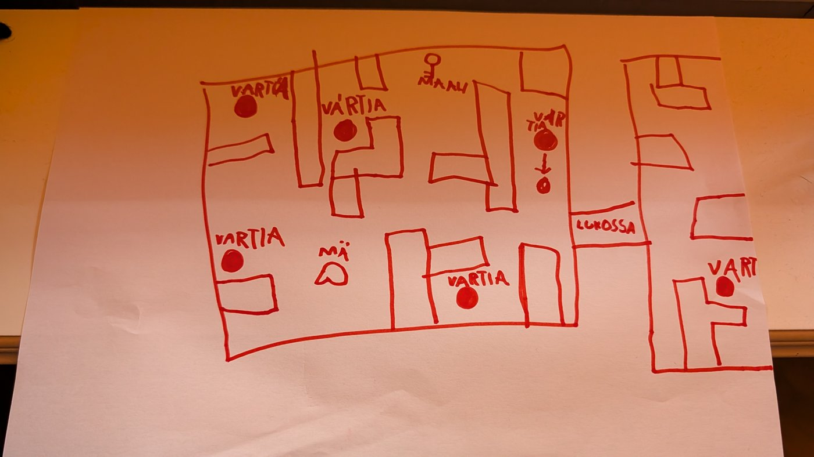

# Hillan peli

Hiiviskelypeli puhelimelle. Hiivi vartijoiden ohi, hae avaimet ja pääse maaliin.

▶ **Pelaa: https://hillan-peli.netlify.app**

## Mistä peli lähti

Hilla piirsi pelin paperille: kartan seinineen, vartijat (VARTIA), oman hahmonsa (MÄ), maalin, avaimen ja lukitun oven (LUKOSSA). Piirroksesta tuli pelin ensimmäinen kenttä, "HILLAN KARTTA", ja sen ympärille rakennettiin loput peli.



Peli on tehty yhdessä Claude Coden kanssa, ja se on kasvanut pelaajan palautteen ja toiveiden mukaan. Esimerkiksi kaupasta saa nyt koirat Aapeli (musta mäyräkoira) ja Muska (jämtlanninpystykorva).

## Mitä pelissä on

- **20 kenttää.** Ensimmäinen on Hillan oma kartta, ja jokainen seuraava tuo yhden uuden jutun:
  - 🌳 pensaat, joissa voi piiloutua
  - 📷 kamerat
  - 🪨 heittokivet, joilla vartijan saa harhautettua
  - 🔴 laserit, jotka vilkkuvat
  - 🔑 värilliset avaimet ja ovet
  - 🎚️ vivut ja portit
  - 🌀 teleportit
  - ❄️ liukas jää
  - 🧪 näkymättömyysjuoma
  - 🐕 nopeat koirat
  - 🌑 pimeät kentät
- **Vartijat erottuvat helposti.** Paikallaan vahtiva on punainen. Kävelevä on violetti, ja sen reitti näkyy lattiassa katkoviivana.
- **Kolme tähteä jokaisessa kentässä:** pääse maaliin, kerää kaikki kolikot ja älä jää kertaakaan näkyviin.
- **🛒 Kauppa:** kolikoilla saa lemmikkejä (mm. Aapeli ja Muska), jälkiä ja heittokiviä.
- **👕 Vaatteet:** tähdillä aukeaa värejä ja hattuja.
- **🏅 Mitalit:** 14 saavutusta.
- **🎨 TEE OMA:** kenttäeditori. Omia kenttiä voi piirtää sormella ja pelata heti.
- **Lukemista harjoittelevalle:** tekstit ovat lyhyitä, isoilla kirjaimilla, ja kuvat auttavat.
- **Puhelinta varten:**
  - Liikkuminen tapahtuu vetämällä sormella mistä kohtaa ruutua tahansa.
  - Peli toimii ilman nettiä, kun se on kerran avattu.
  - Pelin voi lisätä aloitusnäytölle.

## Puhelimeen

1. Avaa https://hillan-peli.netlify.app Chromella.
2. Valitse valikosta ⋮ → **Lisää aloitusnäytölle**.
3. Peli aukeaa jatkossa omana sovelluksenaan ja toimii myös ilman nettiä.

## Kehittäjälle

Peli on tavallista HTML:ää ja JavaScriptiä. Siinä ei ole riippuvuuksia eikä käännösvaihetta.

```bash
python -m http.server 5179      # käynnistä ja avaa http://localhost:5179
node tools/check-levels.js      # tarkista että kentät ovat kunnossa
```

Tarkemmat ohjeet (myös tekoälyagenteille) ovat tiedostossa [AGENTS.md](AGENTS.md).
